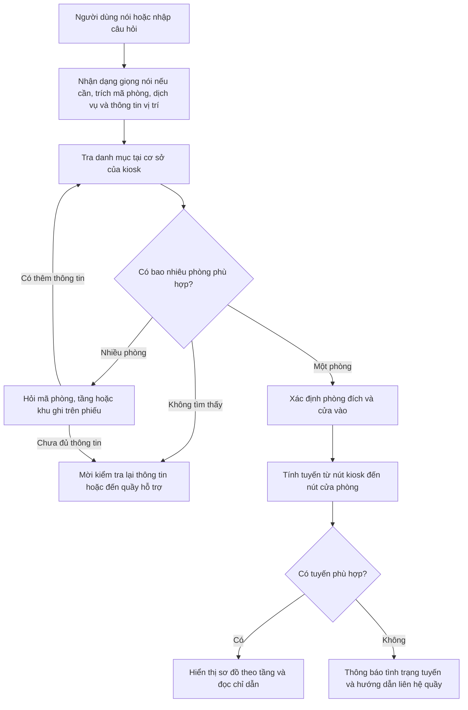

# CareWayV

CareWayV là dự án kiosk chỉ đường trong bệnh viện. Người bệnh hoặc người nhà có thể hỏi bằng giọng nói hoặc nhập thông tin họ đang có, chẳng hạn mã phòng trên phiếu hoặc tên dịch vụ. Kiosk xác định đúng phòng cần đến, sau đó hướng dẫn từ vị trí kiosk đến cửa phòng bằng sơ đồ tầng và lời chỉ dẫn.

## Bài toán

Qua quan sát tại quầy tư vấn, người đến bệnh viện thường hỏi “Phòng 4-002 ở đâu?”, “Tôi đi lấy mẫu nước tiểu thì đến phòng nào?” hoặc “Tôi cần chụp cộng hưởng từ gan, tôi đi lối nào?”. Các câu hỏi này dẫn đến hai việc khác nhau:

1. **Xác định đúng điểm đến.** Mã phòng có thể tra trực tiếp trong phạm vi một cơ sở. Tên dịch vụ có thể khớp với nhiều phòng ở các tầng khác nhau. Khi đó cần thêm thông tin như mã phòng, tầng hoặc khu ghi trên phiếu.
2. **Chỉ đường đến cửa phòng.** Khi đã biết phòng đích, người dùng cần biết mình đang ở đâu, đi qua những mốc nào, đổi tầng ở đâu và nhận ra cửa phòng bằng cách nào. Một số người cần tuyến đi bằng thang máy và các đoạn phù hợp cho xe lăn.

Sơ đồ tầng cho thấy vị trí các phòng, nhưng người dùng có thể vẫn cần hỏi lại để biết nên đi tới phòng nào. Khi nhân viên tư vấn cũng phải tra cứu hoặc hỏi đồng nghiệp, cả người bệnh lẫn quầy tư vấn mất thêm thời gian. CareWayV tập trung vào những lượt hỏi đường có thể xử lý từ danh mục phòng, dịch vụ và sơ đồ đã được xác thực.

## Trải nghiệm dự kiến tại kiosk

Kiosk có thể tận dụng màn hình sơ đồ tầng hiện có. Màn hình hiển thị điểm xuất phát và cho người dùng chọn nói hoặc nhập câu hỏi. Khi hệ thống cần thêm thông tin, nó đặt một câu hỏi cụ thể, ví dụ “Trên phiếu của anh/chị có ghi mã phòng hoặc tầng nào không?”. Khi có điểm đến duy nhất, kiosk hiển thị tên phòng, khu, tầng và hướng dẫn theo từng đoạn. Phần đọc chỉ dẫn giúp người dùng theo dõi mà vẫn có thể nhìn sơ đồ để đối chiếu.

Trong MVP, lộ trình bắt đầu từ vị trí cố định của kiosk. Nếu người dùng đứng ở một kiosk khác, hệ thống dùng vị trí của kiosk đó để tính lại tuyến.

## Luồng từ câu hỏi đến chỉ đường



### 1. Hiểu câu hỏi và tra cứu

Với giọng nói, speech-to-text chuyển âm thanh thành văn bản. Lớp hiểu ngôn ngữ nhận diện những thông tin phục vụ chỉ đường, chẳng hạn mã `4-002`, cụm “chụp MRI” hoặc “tầng 4”. Danh mục bí danh giúp ánh xạ các cách gọi như “MRI” và “cộng hưởng từ” về cùng dịch vụ khi dữ liệu bệnh viện xác nhận quan hệ đó.

Backend tra mã phòng hoặc tìm các phòng cung cấp dịch vụ trong phạm vi cơ sở của kiosk. Khi chọn ứng viên, backend chỉ xét phòng và liên kết dịch vụ đang hoạt động, đồng thời bỏ qua bản ghi đã xóa mềm. Nếu một tên dịch vụ có nhiều kết quả, thông tin bổ sung trên phiếu được dùng để thu hẹp danh sách. Kiosk chuyển người dùng đến quầy hỗ trợ nếu thông tin vẫn chưa đủ để chọn phòng.

### 2. Tính đường đi trong bệnh viện

Sơ đồ đường đi là một đồ thị có hướng. Nút có thể là vị trí kiosk, cửa phòng, giao lộ hành lang hoặc sảnh thang máy. Cạnh nối hai nút theo chiều có thể đi, với loại lối đi như hành lang, cầu thang hoặc thang máy. Lối hai chiều được biểu diễn bằng hai cạnh.

Backend lấy nút xuất phát từ kiosk và nút đích từ phòng. Trước khi tính tuyến, backend loại các cạnh đang đóng. Nếu người dùng chọn tuyến hỗ trợ xe lăn, hệ thống chỉ xét các cạnh được đánh dấu phù hợp. Sau đó, thuật toán như Dijkstra chọn tuyến có tổng chi phí thấp nhất theo thời gian ước tính của từng đoạn. Khi không có tuyến phù hợp, kiosk thông báo để người dùng tìm hỗ trợ tại quầy.

### 3. Trình bày lộ trình

Kiosk gom các đoạn đường theo từng tầng, đánh dấu điểm chuyển tầng và hiển thị điểm đến. Chỉ dẫn bằng lời đi theo thứ tự thực hiện, với các mốc người dùng có thể nhìn thấy như sảnh thang máy, biển khu hoặc số phòng.

Ví dụ minh họa với dữ liệu giả lập: “Từ kiosk ở sảnh tầng 1, đi thẳng đến thang máy A. Lên tầng 4, rẽ phải và đi theo biển khu Chẩn đoán hình ảnh. Phòng 4-002 nằm bên trái.” Một chỉ dẫn tại bệnh viện sẽ dùng tên mốc và hướng đi đã khảo sát tại cơ sở đó.

## Các tình huống cần xử lý

| Người dùng nói hoặc nhập | Kiosk dự kiến xử lý |
| --- | --- |
| “Tôi tìm phòng 4-002.” | Tra mã phòng tại cơ sở của kiosk. Khi tìm được phòng, hiển thị tầng, khu và tuyến tới cửa phòng. |
| “Tôi đi chụp MRI.” | Tra dịch vụ và các phòng đang cung cấp dịch vụ. Nếu có nhiều phòng, hỏi thêm mã phòng, tầng hoặc khu trên phiếu. |
| “Tôi đi chụp MRI gan, trên phiếu ghi tầng 4.” | Đối chiếu tên dịch vụ và tầng với danh mục. Chọn điểm đến khi hai thông tin thu hẹp còn một phòng. |
| “Tôi cần đi bằng xe lăn.” | Tính tuyến theo các đoạn đã được đánh dấu hỗ trợ xe lăn. Nếu chưa có tuyến phù hợp trong dữ liệu, hướng dẫn liên hệ quầy. |
| Người dùng đọc thiếu mã phòng hoặc kiosk nghe chưa rõ. | Mời người dùng nhắc lại hoặc nhập mã phòng trên màn hình. |

## AI tham gia ở đâu?

| Công đoạn | Vai trò của AI | Nguồn dữ liệu quyết định kết quả |
| --- | --- | --- |
| Nhận câu hỏi | Chuyển lời nói thành văn bản, nhận diện mã phòng và cụm từ chỉ dịch vụ. | Câu hỏi của người dùng và danh mục cách gọi để đối chiếu. |
| Làm rõ yêu cầu | Đặt câu hỏi ngắn dựa trên thông tin còn thiếu, chẳng hạn hỏi tầng khi các phòng ứng viên ở nhiều tầng. | Danh sách phòng ứng viên và thông tin người dùng xác nhận. |
| Chỉ đường | Có thể đọc hoặc diễn đạt lại các bước tuyến đường thành lời hướng dẫn dễ nghe. | Đồ thị đường đi, trạng thái các lối và tuyến do backend tính. |

AI hỗ trợ giao tiếp bằng ngôn ngữ tự nhiên. Phòng đích do backend xác định từ danh mục, còn tuyến đường do thuật toán tính từ đồ thị đã được xác thực.

## Nền dữ liệu

| Nhóm dữ liệu | Cách dùng |
| --- | --- |
| Cơ sở, tòa nhà, tầng | Xác định phạm vi tra cứu và sơ đồ tương ứng. |
| Khoa, phòng | Lưu mã và tên phòng, khoa quản lý nếu có, cùng nút cửa vào. |
| Dịch vụ, bí danh, phòng cung cấp dịch vụ | Đối chiếu cách gọi của người dùng và tìm các phòng ứng viên. Một dịch vụ có thể có nhiều phòng. |
| Nút và cạnh đường đi | Lưu kết nối giữa các mốc, chiều đi, chuyển tầng, trạng thái mở và khả năng tiếp cận. |
| Kiosk | Gắn mỗi màn hình với một nút xuất phát trong đúng cơ sở. |

Các liên kết phòng, dịch vụ, kiosk và đồ thị được giới hạn bằng khóa ngoại theo cơ sở. Chi tiết 11 bảng, ERD và nguồn tham khảo nằm trong [thiết kế cơ sở dữ liệu](docs/wayfinding-database.md).

## Trạng thái và hướng triển khai

Repo có FastAPI, 11 bảng SQLAlchemy, PostgreSQL, migration Alembic và bộ dữ liệu chỉ đường mô phỏng tầng 3–4. Docker Compose chạy `frontend`, `api` và `db`. API áp dụng migration trước khi khởi động. Frontend Vue 3 gọi API để tra điểm đến, làm rõ khi có nhiều kết quả và hiển thị tuyến chỉ đường song ngữ.

1. **Chuẩn bị dữ liệu cho một khu vực.** Dùng sơ đồ và danh mục phòng được xác thực. Gắn vị trí kiosk, cửa phòng và các mốc chuyển tầng vào đồ thị. Đánh dấu chiều đi, đoạn đang mở và khả năng tiếp cận.
2. **Làm luồng chỉ đường bằng văn bản.** Nhập mã phòng hoặc tên dịch vụ, xử lý trường hợp nhiều điểm đến, sau đó trả tuyến và hiển thị sơ đồ tầng. Đây là luồng để kiểm tra dữ liệu và thuật toán trước khi tích hợp giọng nói.
3. **Tích hợp Voice AI.** Thêm nhận dạng giọng nói tiếng Việt, câu hỏi làm rõ và đọc lại chỉ dẫn. Kiểm tra với cách đọc mã phòng khác nhau, tên dịch vụ và tiếng ồn tại sảnh.
4. **Mở rộng sau MVP.** Nếu có dữ liệu lịch hẹn từ bệnh viện, kiosk có thể quét QR chứa mã tham chiếu để tra phòng được phân công. Cảm biến khoảng cách có thể kích hoạt lời chào khi người dùng đứng trước kiosk.

Kịch bản demo tối thiểu gồm tìm phòng bằng mã, hỏi tên dịch vụ có nhiều phòng và xác nhận thêm thông tin, cùng một tuyến đổi tầng qua thang máy. Có thể đánh giá bằng tỷ lệ chọn đúng phòng, thời gian từ lúc hỏi đến lúc nhận hướng dẫn và số lượt phải chuyển qua quầy tư vấn.

## Chạy CareWayV

Từ thư mục gốc, với Docker Compose đang sẵn sàng:

```bash
test -f .env || cp .env.example .env
docker compose up -d --build --wait
docker compose ps
```

Với database mới, [nạp dữ liệu chỉ đường mô phỏng](#nạp-dữ-liệu-chỉ-đường-mô-phỏng-tầng-3-và-4) trước khi thử tìm tuyến.

Mở [frontend kiosk](http://127.0.0.1:5173) hoặc [Swagger UI](http://127.0.0.1:8000/docs). Có thể đặt `CAREWAYV_FRONTEND_PORT` trong `.env` để đổi cổng giao diện. Lệnh kiểm tra database, cấu hình `.env` và cách sinh revision mới nằm trong [hướng dẫn Docker Compose và Alembic](docs/database-migrations.md).

### Phát triển frontend

Chạy các lệnh sau khi API đã có dữ liệu mẫu. Vite dùng `.env` ở thư mục gốc để chuyển các request `/gateway/` đến API cục bộ. Docker Compose dùng Nginx cho cùng cơ chế proxy.

```bash
docker compose up -d --wait api
cd frontend
npm ci
npm run dev
```

Nếu container frontend đang giữ cổng 5173, chạy Vite bằng `npm run dev -- --port 5174`. `npm run build` tạo bản production trong `frontend/dist/`. Trình duyệt cần quyền microphone và một secure context để thu âm. HTTPS hoặc localhost đáp ứng yêu cầu đó. Người dùng có thể tải tệp WAV, MP3 hoặc WebM qua tab giọng nói. Cả hai cách gửi âm thanh dùng `OPENROUTER_API_KEY` ở backend. [Nghiên cứu thiết kế frontend](docs/frontend-design-research.md)

## Nạp dữ liệu chỉ đường mô phỏng tầng 3 và 4

Tên và thứ tự các khu dựa trên hai ảnh biển sơ đồ. Phòng, tọa độ hành lang,
chỉ dẫn từng đoạn, khoảng cách, thời gian và khả năng tiếp cận là dữ liệu giả lập.
Các nút và cạnh trong PostgreSQL mô tả đường từ hai kiosk tới lối vào khu và
cửa phòng. Cột `floors.map_asset_url` để trống.

Bộ dữ liệu có 20 phòng cho mỗi nhóm chuyên môn, 6 điểm phục vụ của nhà thuốc
và 2 điểm tại mỗi quầy thanh toán, tổng cộng 450 phòng/điểm phục vụ trong 25 khu.
Mã như `3-01-09` chỉ tầng 3, khu số 01, phòng số 09. Trong DB, dữ liệu thuộc
cơ sở mô phỏng riêng `VINMEC-DEMO-F34`.

```bash
docker compose up -d --wait db
venv/bin/python -m alembic upgrade head
venv/bin/python -m app.db.seeds.vinmec_floors_3_4.seed
```

Dùng đường dẫn Python của virtualenv đang cài các gói trong `requirements.txt`.
Nếu đã chạy API trong Compose, có thể nạp dữ liệu bằng
`docker compose exec api python -m app.db.seeds.vinmec_floors_3_4.seed`.
Khi chạy lại, seed giữ ID hiện có và làm mới mô tả, tọa độ, trạng thái của
các bản ghi thuộc bộ dữ liệu mô phỏng.

## API chỉ đường

Hai endpoint khai báo tại `app/api/wayfinding.py`. `app/api/__init__.py` tập hợp router để `app/main.py` gắn vào FastAPI. `app/core/config.py` đọc tiền tố, tag Swagger, Cache-Control và mã lỗi từ `.env`. Xem các biến trong `.env.example`. `WAYFINDING_ERROR_STATUS` nhận một object JSON và cho phép ghi đè từng mã. Sau khi đổi cấu hình, chạy `docker compose up -d --wait api frontend` để áp dụng cho cả API và proxy. [Swagger UI](http://127.0.0.1:8000/docs)

- `POST /api/v1/wayfinding/text` nhận `kiosk_code`, `text` và tùy chọn `wheelchair`.
- `POST /api/v1/wayfinding/voice` nhận `kiosk_code`, `audio_base64` và `format`.
  Mỗi request là một câu thu âm, tối đa 2 MiB trước khi mã hóa base64. WAV là
  định dạng mặc định. Giọng nói trả về là MP3 ở `audio_base64`. Đặt
  `speak: false` để chỉ nhận bản chép lời và kết quả chỉ đường.

Cả hai API nhận `language: "auto" | "vi" | "en"`, mặc định là `auto`, và trả
trường `language` cho biết ngôn ngữ phản hồi. Có thể gửi `en` hoặc `vi` khi kiosk
đã biết ngôn ngữ người dùng chọn. Với voice ở chế độ tự động, Whisper nhận diện
ngôn ngữ của từng câu. Mã phòng dùng chung cho cả hai ngôn ngữ. Danh mục tiếng Anh
có tên 25 khu và bí danh cho các dịch vụ đã cấu hình. Tên và mô tả gốc của các
phòng vẫn dùng dữ liệu tiếng Việt, còn từng bước chỉ đường có bản tiếng Anh.

```bash
curl -fsS http://127.0.0.1:8000/api/v1/wayfinding/text \
  -H 'Content-Type: application/json' \
  -d '{"kiosk_code":"KIOSK-3","text":"Chỉ đường tới phòng 4-04-11","wheelchair":true}'
```

Kết quả `route` gồm điểm xuất phát, cửa đến, thời gian ước tính và từng đoạn
có tọa độ, tầng, loại lối đi và câu chỉ dẫn. Khi `status` là `clarify`,
hiển thị hoặc đọc `message` và gửi lại `context` nguyên vẹn cùng câu trả lời
tiếp theo. Giữ ngữ cảnh ở phiên kiosk đang hoạt động và bỏ khi kết thúc phiên.
Hai trạng thái `not_found` và `no_route` cung cấp câu phản hồi cho người dùng.

Để gọi OpenRouter thật, thêm `OPENROUTER_API_KEY` vào `.env` và chạy
`docker compose up -d --wait api` để áp dụng cấu hình. Khi TTS lỗi,
`speech_status: unavailable` vẫn đi kèm `message` và kết quả tuyến.
Khi chưa cấu hình key hoặc STT lỗi, dùng endpoint văn bản. Xem
[nghiên cứu lựa chọn model và trạng thái hội thoại](docs/voice-wayfinding-research.md).

Kiểm thử qua HTTP với PostgreSQL đã migrate và seed theo hướng dẫn trên.
OpenRouter được mock trong tiến trình kiểm thử:

```bash
venv/bin/python -m unittest discover -s tests -p 'test_wayfinding_bilingual.py' -v
```
