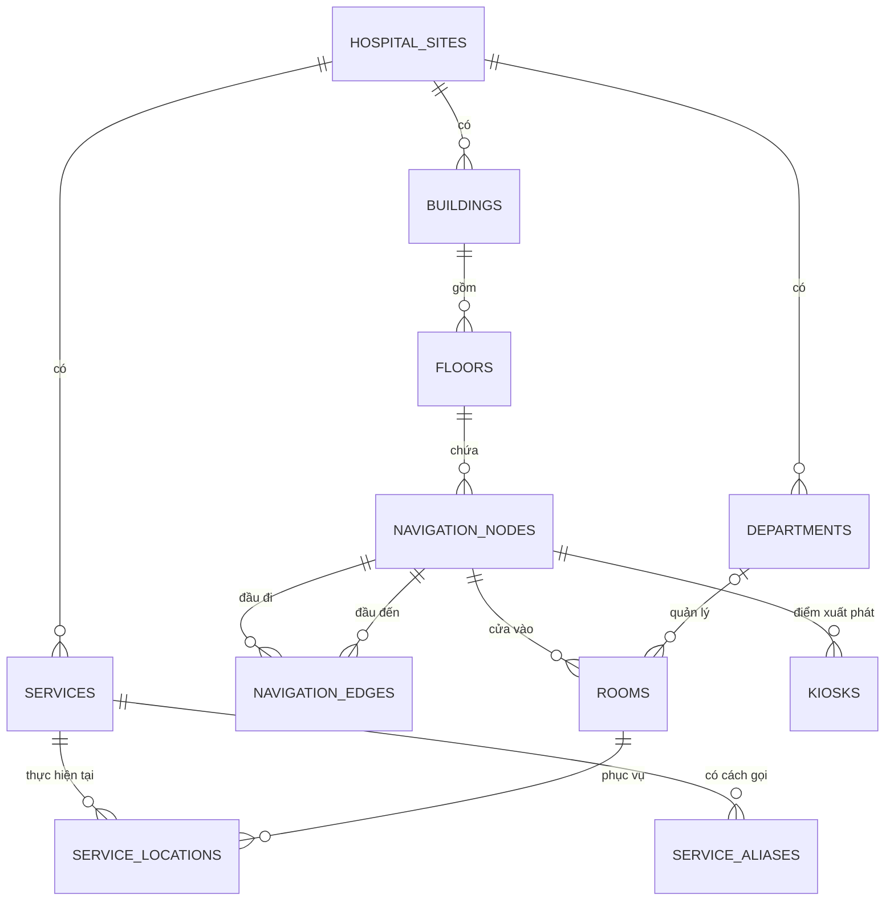

# Thiết kế cơ sở dữ liệu chỉ đường CareWayV

Kiosk cần xác định phòng đích và biết những lối có thể đi từ vị trí kiosk đến cửa phòng. Một người có thể đọc mã phòng trên phiếu hoặc chỉ nói tên dịch vụ. Khi một dịch vụ được thực hiện ở nhiều tầng, danh mục trả về các phòng phù hợp để ứng dụng có thể hỏi thêm thông tin trước khi chọn điểm đến.

## Sơ đồ quan hệ

| Bảng | Vai trò |
| --- | --- |
| `hospital_sites`, `buildings`, `floors` | Phân cấp cơ sở → tòa nhà → tầng. Mỗi tầng có nhãn hiển thị và có thể trỏ đến ảnh sơ đồ. |
| `navigation_nodes` | Điểm trên một tầng, chẳng hạn cửa phòng, vị trí kiosk hoặc sảnh thang máy. Tọa độ `x` và `y` có thể để trống cùng nhau, hoặc cùng nằm trong khoảng 0–1 theo kích thước sơ đồ tầng. |
| `navigation_edges` | Lối đi có hướng giữa hai nút. Mỗi cạnh có loại `walk`, `stairs` hoặc `elevator`, chi phí dương tính bằng giây, trạng thái hoạt động và thông tin hỗ trợ xe lăn. Lối hai chiều có hai cạnh. |
| `departments`, `rooms` | Danh mục khoa và phòng. Mỗi phòng có một nút cửa vào và có thể thuộc một khoa. Thiết kế dùng mã phòng duy nhất trong phạm vi cơ sở. |
| `services`, `service_aliases` | Danh mục dịch vụ và cách gọi như “MRI” hoặc “cộng hưởng từ”. Khi nhập danh mục, lớp ứng dụng sẽ điền `normalized_name` và `normalized_alias` theo cùng quy tắc chuẩn hóa. Một bí danh có thể khớp nhiều dịch vụ. |
| `service_locations` | Liên kết nhiều–nhiều giữa dịch vụ và phòng có cung cấp dịch vụ đó. Có thể đánh dấu từng liên kết đang hoạt động. |
| `kiosks` | Mỗi kiosk gắn với một nút trên đồ thị làm điểm xuất phát. |

Các khóa ngoại ghép theo `site_id` giữ tòa nhà, tầng, nút, phòng, kiosk và dịch vụ trong đúng cơ sở khi tạo liên kết. PostgreSQL hỗ trợ loại ràng buộc này khi tổ hợp cột được tham chiếu có khóa chính hoặc ràng buộc duy nhất. [PostgreSQL — Foreign Keys](https://www.postgresql.org/docs/17/ddl-constraints.html#DDL-CONSTRAINTS-FK)

## Cơ sở kỹ thuật

- **Sơ đồ tầng và đồ thị đường đi.** IndoorGML mô tả kết nối giữa các không gian trong nhà bằng đồ thị. CareWayV lưu tọa độ nút để hiển thị trên sơ đồ và lưu cạnh để biểu diễn lối thực sự có thể đi. Khi triển khai định tuyến, Dijkstra có thể tìm đường theo chi phí dương sau khi lọc cạnh đã đóng hoặc cạnh không hỗ trợ xe lăn theo lựa chọn của người dùng. [OGC IndoorGML 2.0](https://docs.ogc.org/is/22-045r5/22-045r5.pdf), [NetworkX — Shortest Paths](https://networkx.org/documentation/stable/reference/algorithms/shortest_paths.html#algorithms)
- **ORM và migration.** SQLAlchemy định nghĩa bảng và ràng buộc. Alembic đọc metadata để đề xuất revision, trong khi revision đã lưu là cơ sở để tạo lại schema. Về sau, endpoint FastAPI có thể dùng dependency với `yield` để cấp và đóng session theo request. [Alembic — Autogenerate](https://alembic.sqlalchemy.org/en/latest/autogenerate.html), [FastAPI — Database Dependency](https://fastapi.tiangolo.com/tutorial/dependencies/dependencies-with-yield/#a-database-dependency-with-yield)
- **Voice AI và trường hợp nhiều điểm đến.** Ứng dụng giọng nói có thể trích mã phòng, tên dịch vụ hoặc tầng được nhắc trong câu hỏi, sau đó đối chiếu với danh mục. Nếu câu “Tôi đi chụp MRI” trả về nhiều phòng, kiosk có thể hỏi thêm mã phòng hoặc đề nghị người dùng xác nhận. Dữ liệu dịch vụ và sơ đồ là nguồn xác định điểm đến và tuyến đường.
- **Lịch hẹn sau MVP.** Nếu bệnh viện cung cấp giao diện tra cứu, QR có thể mang mã tham chiếu ngắn hạn để hệ thống lấy địa điểm được phân công rồi ánh xạ sang phòng CareWayV. FHIR R4 hỗ trợ `Location` trong danh sách thành phần tham gia lịch hẹn. [HL7 FHIR R4 — Appointment](https://www.hl7.org/fhir/R4/appointment-definitions.html#Appointment.participant.actor)

Migration `0001` tạo schema chỉ đường. Revision `0002` thêm các cột audit và soft delete cho cả 11 bảng. Xem [hướng dẫn chạy migration](database-migrations.md).
